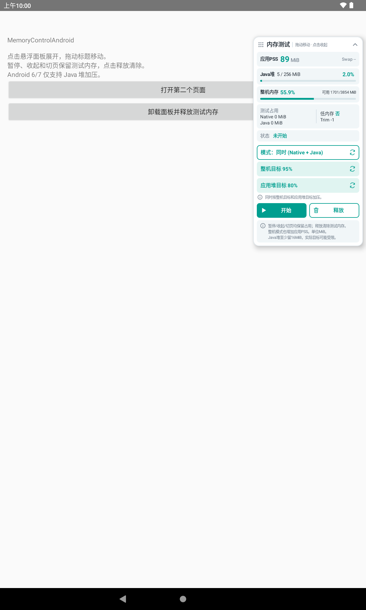
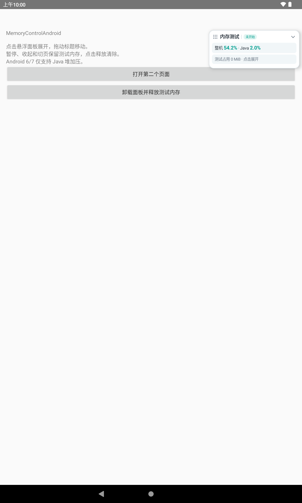

# MemoryControlAndroid

从 `MemoryPressureFloatingPanel` 提取的 Android 内存监控和加压库。纯 Java，只有 Android framework 依赖，不需要悬浮窗权限，不依赖业务 Activity 基类。

## 功能

- 悬浮面板跟随前台 Activity，支持拖动、折叠和跨页面保留状态。
- 后台采样应用 PSS、Swap PSS、Java 堆、整机内存及低内存回调。
- 支持 Native 像素内存、Java 堆和两者同时加压，可调整目标比例。
- 暂停、收起、切页和进入后台均保留测试占用；手动释放只清除测试器持有的内存。
- 依据**宿主的 `FLAG_DEBUGGABLE`** 决定是否安装及开始采样/加压，使用 release AAR 也能在宿主调试包中正常工作。

支持 Android 6.0 / API 23 及以上。Native 和混合加压需要 Android 8.0 / API 26；Android 6/7 面板默认使用 Java 堆模式。

## Demo 实机截图

Demo 已通过 `:sample:assembleDebug` 编译，并在 Lenovo TB223FC（Android 12）上安装运行；已验证面板拖动、展开/收起和页面切换。以下为实机截图，点击可查看原图。

| 展开状态 | 收起状态 |
| --- | --- |
|  |  |

## Gradle 依赖

在宿主 `settings.gradle` 中添加 JitPack 仓库，保留已有的其他仓库：

```groovy
dependencyResolutionManagement {
    repositories {
        google()
        mavenCentral()
        maven { url 'https://jitpack.io' }
    }
}
```

在 app 模块中添加：

```groovy
dependencies {
    implementation 'com.github.kingslou:MemoryControlAndroid:1.0.1'
}
```

首次通过 JitPack 获取一个版本时，JitPack 会构建该 Git 标签。构建状态和日志：[1.0.1](https://jitpack.io/#kingslou/MemoryControlAndroid/1.0.1)。此仓库使用 Maven Publish 发布根项目的 release AAR 和源码包，示例 app 不参与发布。

如果只在调试包中保留库代码，可使用 `debugImplementation`，并将所有引用该库的代码放在 `src/debug` 中；不要在 `src/main` 直接引用仅存在于 debug 编译路径的类。

## 安装面板

在自己的 `Application.onCreate()` 中、首个 Activity 恢复前调用：

```java
import io.github.kingslou.memorycontrol.MemoryPressureFloatingPanel;

public class MyApplication extends Application {
    @Override
    public void onCreate() {
        super.onCreate();
        MemoryPressureFloatingPanel.install(this);
    }
}
```

记得在宿主清单中注册自己的 Application。Kotlin 中同样调用 `MemoryPressureFloatingPanel.install(this)` 即可。

`install`、`uninstall`、`isInstalled` 必须在主线程调用。重复安装不重复注册。安装后会在下一次 Activity 恢复时挂载面板。

```java
boolean installed = MemoryPressureFloatingPanel.isInstalled();
MemoryPressureFloatingPanel.uninstall();
```

卸载会移除窗口和生命周期回调，并异步释放测试内存。可再次安装；后台工作线程保留供进程内复用。

多进程应用应自行在需要的进程中安装。每个进程独立持有状态和测试内存，库不会自动判断主进程。

## 直接调用加压器

无需安装面板也可以使用。以下方法可以在任意线程调用，实际分配、释放及采样在内部工作线程串行执行：

```java
import io.github.kingslou.memorycontrol.MemoryPressureSimulator;

// 同时加压：整机目标 90%，Java 堆目标 80%，每行随机像素 512。
MemoryPressureSimulator.start(
        application,
        MemoryPressureSimulator.MODE_BOTH,
        90,
        80,
        512);

// 停止新增分配，已有测试占用继续保留。
MemoryPressureSimulator.pause();

// 异步清除 Native 像素和 Java 数组，不清除宿主的业务缓存。
MemoryPressureSimulator.release();

// 异步请求采样；getSnapshot 返回最近一次完成的快照，并非同步采样结果。
MemoryPressureSimulator.requestSample(application);
MemoryPressureSimulator.Snapshot snapshot = MemoryPressureSimulator.getSnapshot();

// 输出事件时间及后续后台采样，日志标签为 MemoryControl。
MemoryPressureSimulator.recordCheckpoint("页面提交完成");
```

| 参数 / 模式 | 含义 |
| --- | --- |
| `MODE_SYSTEM` | 通过本进程 Bitmap Native 像素增加设备内存压力，也会增加本进程 PSS |
| `MODE_APP` | 增加本进程 Java 数组占用 |
| `MODE_BOTH` | 两者同时推进 |
| `targetUsedPercent` | 整机目标，1～99，依据 `(totalMem - availMem) / totalMem` 估算 |
| `targetJavaPercent` | Java 已用堆 / 最大堆目标，1～95，另保留至少 16 MiB 分配余量 |
| `noisyPixelsPerRow` | 每行随机像素数量，0～1024，用于调整像素数据的可压缩性 |

`start(context)` 简写使用 Native 模式、95% 整机目标和 512 个随机像素；面板在 API 26+ 默认选择混合模式、95% 整机目标和 80% Java 堆目标。参数只能在暂停后调整，运行中再次调用 `start` 不改变当前任务。达到目标或分配上限后暂停新增分配并保留已有占用。

`Snapshot` 不可变，可跨线程读取。字段以 `Mb` 命名但单位统一为 **MiB（1024 × 1024 字节）**。PSS 未采样、Swap 字段不可用、整机使用率未知时返回 `-1`；`trimLevel = -1` 表示尚未收到回调。测试占用和 PSS 是不同指标，不应相加。`pause`、`release` 返回时，后台任务及快照更新可能尚未完成。

## 本地源码或 AAR 接入

也可以将此仓库作为本地 Gradle 模块引入，或发布到本机 Maven 仓库。开发环境为 JDK 17、Android SDK 34、AGP 8.4.2、Gradle 8.6；宿主消费 AAR 不要求使用相同 AGP。

```powershell
# 生成 build/outputs/aar/MemoryControlAndroid-release.aar
.\gradlew.bat :assembleRelease

# 发布到本机 Maven 仓库，再由宿主通过 mavenLocal() 依赖相同坐标
.\gradlew.bat :publishReleasePublicationToMavenLocal

# 安装示例 app 到已连接的设备
.\gradlew.bat :sample:installDebug
```

`sample` 演示 Application 安装、前后台切换、两个 Activity 之间切换及卸载。核心类在 `src/main/java/io/github/kingslou/memorycontrol/`，图标均使用 `mc_` 前缀以减少宿主资源冲突。

## 使用边界

这是主动制造内存压力的开发工具。高目标可能造成卡顿、OOM、系统低内存回收甚至进程退出；至少 16 MiB 的 Java 分配余量不能保证业务仍有足够内存。捕获分配失败时会尝试释放测试块，无法拦截系统杀进程或 Native 崩溃。

整机目标会受其他进程、系统回收和页面压缩影响，不能保证精确达到；Native 块受整机 RAM 两倍的动态上限约束，32 位进程另受 1536 MiB 上限约束。系统低内存及 Trim 回调是否到达取决于 Android 版本和设备实现，`UI_HIDDEN` 只表示退后台。库不主动发送伪造的内存回调。

非 debuggable 宿主不会安装面板，也不会开始采样或加压。建议仅将库集成到开发与测试包。
